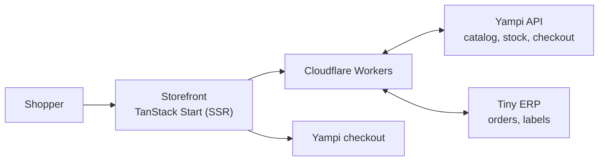

<h1 align="center">VYTA Store</h1>

Headless e-commerce with server-side rendering on Cloudflare and Yampi checkout

    

<a href="https://vytacore.com.br"><b>Live store</b></a>

> **Note:** the source code is private (production systems). This repository is a technical overview: what it does, how it is built and what it looks like. Happy to walk through the code in an interview — reach me on [LinkedIn](https://www.linkedin.com/in/guilherme-vytacore/).

## Overview

The brand's official online store, live at [vytacore.com.br](https://vytacore.com.br). The storefront is custom-built with server-side rendering; catalog, inventory and checkout come from Yampi through its API.

## Highlights

- **SSR with TanStack Start**, deployed to Cloudflare (Workers/Pages via Nitro)
- **Yampi API integration**: products, SKUs, inventory, coupons, free-shipping rules, product reviews and webhooks
- **Bundles and kits** assembled in the store with native checkout
- **Split orders across suppliers**, each with its own shipping label
- **Partner portal** integrated with Tiny ERP, with access rules enforced server-side
- **Order tracking** linked to the customer area
- **40+ test and probe scripts** covering the storefront, cart and purchase flows

## Architecture

## Tech stack

- **Frontend:** TanStack Start, React 19, TypeScript, Zustand, TanStack Query, Tailwind CSS v4, shadcn/ui
- **Integrations:** Yampi, Tiny ERP
- **Infrastructure:** Cloudflare, Supabase

---

<b>Versão em português</b>

> **Observação:** o código-fonte é privado (sistemas em produção). Este repositório é uma visão técnica do projeto. Posso apresentar o código em uma entrevista — fale comigo pelo [LinkedIn](https://www.linkedin.com/in/guilherme-vytacore/).

## Visão geral

Loja oficial da marca, no ar em [vytacore.com.br](https://vytacore.com.br). O front é próprio, com renderização no servidor; catálogo, estoque e checkout vêm da Yampi pela API.

## Destaques

- **SSR com TanStack Start** publicado no Cloudflare
- **Integração com a API da Yampi**: produtos, SKUs, estoque, cupons, frete grátis, comentários e webhooks
- **Kits e combos** com checkout nativo
- **Pedidos divididos entre fornecedores**, com etiquetas separadas
- **Portal de parceiro** integrado ao ERP Tiny
- **Rastreio de pedidos** na área do cliente
- **40+ scripts de teste** da vitrine e dos fluxos de compra

## Stack

- **Frontend:** TanStack Start, React 19, TypeScript, Zustand, TanStack Query, Tailwind CSS v4, shadcn/ui
- **Integrações:** Yampi, Tiny ERP
- **Infra:** Cloudflare, Supabase

